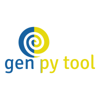
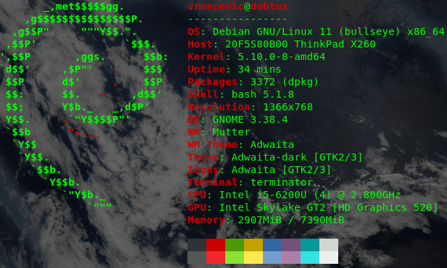
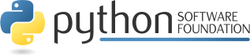

# Generate Python tool project setup



**gen_py_tool** is toolset for generation of Clean Architecture Python tool project setup.

Developed in **[python](https://www.python.org/)** code.

The README is used to introduce the modules and provide instructions on
how to install the modules, any machine dependencies it may have and any
other information that should be provided before the modules are installed.

[](https://github.com/vroncevic/gen_py_tool/actions/workflows/gen_py_tool_python_checker.yml) [](https://github.com/vroncevic/gen_py_tool/actions/workflows/gen_py_tool_package_checker.yml) [](https://github.com/vroncevic/gen_py_tool/actions/workflows/gen_py_tool_interface_checker.yml) [](https://github.com/vroncevic/gen_py_tool/actions/workflows/gen_py_tool_isp_checker.yml) [](https://github.com/vroncevic/gen_py_tool/actions/workflows/gen_py_tool_srp_checker.yml) [](https://github.com/vroncevic/gen_py_tool/issues) [](https://github.com/vroncevic/gen_py_tool/graphs/contributors)

<!-- START doctoc generated TOC please keep comment here to allow auto update -->
<!-- DON'T EDIT THIS SECTION, INSTEAD RE-RUN doctoc TO UPDATE -->
**Table of Contents**

- [🚀 Installation](#-installation)
    - [Install using pip](#install-using-pip)
    - [Install using build](#install-using-build)
    - [Install using py setup](#install-using-py-setup)
    - [Install using docker](#install-using-docker)
- [📦 Dependencies](#-dependencies)
- [📁 Tool structure](#-tool-structure)
  - [✨ Features](#-features)
- [📊 Code coverage](#-code-coverage)
- [🛠 Usage](#-usage)
- [📚 Docs](#-docs)
- [👥 Contributing](#-contributing)
- [📄 Copyright and licence](#-copyright-and-licence)

<!-- END doctoc generated TOC please keep comment here to allow auto update -->

### 🚀 Installation

Used next development environment



[](https://github.com/vroncevic/gen_py_tool/actions/workflows/gen_py_tool_python3_build.yml)

Currently there are four ways to install package
* Install process based on using pip mechanism
* Install process based on build mechanism
* Install process based on setup.py mechanism
* Install process based on docker mechanism

##### Install using pip

**gen_py_tool** is located at **[pypi.org](https://pypi.org/project/gen_py_tool/)**.

You can install by using pip

```bash
# python3
pip3 install gen_py_tool
```

##### Install using build

Navigate to release **[page](https://github.com/vroncevic/gen_py_tool/releases/)** download and extract release archive.

To install **gen_py_tool** type the following

```bash
tar xvzf gen_py_tool-x.y.z.tar.gz
cd gen_py_tool-x.y.z/
# python3
wget https://bootstrap.pypa.io/get-pip.py
python3 get-pip.py
python3 -m pip install --upgrade setuptools
python3 -m pip install --upgrade pip
python3 -m pip install --upgrade build
pip3 install -r requirements.txt
python3 -m build --no-isolation --wheel
pip3 install ./dist/gen_py_tool-*-py3-none-any.whl
rm -f get-pip.py
```

##### Install using py setup

Navigate to **[release page](https://github.com/vroncevic/gen_py_tool/releases)** download and extract release archive.

To install **gen_py_tool** locate and run setup.py with arguments

```bash
tar xvzf gen_py_tool-x.y.z.tar.gz
cd gen_py_tool-x.y.z
# python3
pip3 install -r requirements.txt
python3 setup.py install_lib
python3 setup.py install_egg_info
```

##### Install using docker

You can use Dockerfile to create image/container.

### 📦 Dependencies

**gen_py_tool** requires next modules and libraries

* [ats-utilities - Python App/Tool/Script Utilities](https://pypi.org/project/ats-utilities/)

### 📁 Tool structure

**gen_py_tool** is based on OOP and Clean Architecture.

Tool structure

<details>
<summary><b>Click to expand framework structure</b></summary>

```bash
    gen_py_tool/
         ├── core/
         │   ├── __init__.py
         │   ├── model/
         │   │   ├── __init__.py
         │   │   └── project_setup.py
         │   └── service/
         │       ├── engine.py
         │       ├── __init__.py
         │       ├── iservice.py
         │       └── isubprocessor.py
         ├── engine.py
         ├── infrastructure/
         │   ├── cli/
         │   │   ├── engine.py
         │   │   ├── icli.py
         │   │   ├── __init__.py
         │   │   └── setup/
         │   │       ├── bundle.py
         │   │       ├── dep_validator.py
         │   │       ├── dependencies.py
         │   │       ├── factory.py
         │   │       ├── __init__.py
         │   │       ├── keys.py
         │   │       ├── opt_validator.py
         │   │       ├── options.py
         │   │       ├── registry.py
         │   │       └── validator.py
         │   ├── command/
         │   │   ├── bundle.py
         │   │   ├── definition.py
         │   │   ├── executor.py
         │   │   ├── idefinition.py
         │   │   ├── iexecutor.py
         │   │   └── __init__.py
         │   ├── config/
         │   │   ├── gen_py_tool.cfg
         │   │   ├── gen_py_tool.logo
         │   │   ├── scheme.json
         │   │   └── templates.tgz
         │   ├── __init__.py
         │   └── subprocessor.py
         ├── __init__.py
         ├── py.typed
         └── setup/
             ├── bundle.py
             ├── dep_validator.py
             ├── dependencies.py
             ├── factory.py
             ├── __init__.py
             ├── keys.py
             ├── opt_validator.py
             ├── options.py
             ├── registry.py
             └── validator.py

     10 directories, 45 files
```
</details>

#### ✨ Features

* Automatically scaffolds minimal Clean Architecture Python CLI tool projects ready for customization.
* Generated starter tool includes a complete Clean Architecture pipeline (`CLI` -> `Command` -> `Service` -> `SubProcessor` writing to `stdout`), 1-to-1 unit tests, Sphinx docs, and GitHub Actions workflows.
* Strictly adheres to SOLID principles, structural `Protocol` interfaces, and inward dependency inversion.
* Robust validation of project bundles, dependencies, and options via `ats-utilities`.
* High code quality with full static typing and 100% unit test coverage.

### 📊 Code coverage

<details>
<summary><b>Click to expand code coverage</b></summary>

| Name | Stmts | Miss | Cover |
|------|-------|------|-------|
| `gen_py_tool/__init__.py` | 9 | 0 | 100%|
| `gen_py_tool/core/__init__.py` | 9 | 0 | 100%|
| `gen_py_tool/core/model/__init__.py` | 9 | 0 | 100%|
| `gen_py_tool/core/model/project_setup.py` | 14 | 0 | 100%|
| `gen_py_tool/core/service/__init__.py` | 9 | 0 | 100%|
| `gen_py_tool/core/service/engine.py` | 34 | 0 | 100%|
| `gen_py_tool/core/service/iservice.py` | 14 | 0 | 100%|
| `gen_py_tool/core/service/isubprocessor.py` | 14 | 0 | 100%|
| `gen_py_tool/engine.py` | 57 | 0 | 100%|
| `gen_py_tool/infrastructure/__init__.py` | 9 | 0 | 100%|
| `gen_py_tool/infrastructure/cli/__init__.py` | 9 | 0 | 100%|
| `gen_py_tool/infrastructure/cli/engine.py` | 43 | 0 | 100%|
| `gen_py_tool/infrastructure/cli/icli.py` | 16 | 0 | 100%|
| `gen_py_tool/infrastructure/cli/setup/__init__.py` | 9 | 0 | 100%|
| `gen_py_tool/infrastructure/cli/setup/bundle.py` | 23 | 0 | 100%|
| `gen_py_tool/infrastructure/cli/setup/dep_validator.py` | 33 | 0 | 100%|
| `gen_py_tool/infrastructure/cli/setup/dependencies.py` | 19 | 0 | 100%|
| `gen_py_tool/infrastructure/cli/setup/factory.py` | 29 | 0 | 100%|
| `gen_py_tool/infrastructure/cli/setup/keys.py` | 26 | 0 | 100%|
| `gen_py_tool/infrastructure/cli/setup/opt_validator.py` | 33 | 0 | 100%|
| `gen_py_tool/infrastructure/cli/setup/options.py` | 17 | 0 | 100%|
| `gen_py_tool/infrastructure/cli/setup/registry.py` | 24 | 0 | 100%|
| `gen_py_tool/infrastructure/cli/setup/validator.py` | 35 | 0 | 100%|
| `gen_py_tool/infrastructure/command/__init__.py` | 9 | 0 | 100%|
| `gen_py_tool/infrastructure/command/bundle.py` | 19 | 0 | 100%|
| `gen_py_tool/infrastructure/command/definition.py` | 29 | 0 | 100%|
| `gen_py_tool/infrastructure/command/executor.py` | 32 | 0 | 100%|
| `gen_py_tool/infrastructure/command/idefinition.py` | 21 | 0 | 100%|
| `gen_py_tool/infrastructure/command/iexecutor.py` | 15 | 0 | 100%|
| `gen_py_tool/infrastructure/subprocessor.py` | 62 | 0 | 100%|
| `gen_py_tool/setup/__init__.py` | 9 | 0 | 100%|
| `gen_py_tool/setup/bundle.py` | 25 | 0 | 100%|
| `gen_py_tool/setup/dep_validator.py` | 33 | 0 | 100%|
| `gen_py_tool/setup/dependencies.py` | 21 | 0 | 100%|
| `gen_py_tool/setup/factory.py` | 45 | 0 | 100%|
| `gen_py_tool/setup/keys.py` | 27 | 0 | 100%|
| `gen_py_tool/setup/opt_validator.py` | 33 | 0 | 100%|
| `gen_py_tool/setup/options.py` | 12 | 0 | 100%|
| `gen_py_tool/setup/registry.py` | 24 | 0 | 100%|
| `gen_py_tool/setup/validator.py` | 38 | 0 | 100%|
| **Total** | 948 | 0 | 100% |

</details>

### 🛠 Usage

Install package

```bash
pip3 install gen_py_tool
```

Prepare main entry point by downloading [main.py](https://raw.githubusercontent.com/vroncevic/gen_py_tool/main/main.py) or create your own.

```bash
wget -O main.py https://raw.githubusercontent.com/vroncevic/gen_py_tool/main/main.py
```

Running tool for creating a new Python tool starter project:

```bash
python3 main.py create --name my_tool --output ./demo/
```

Running the generated Python tool starter project:

```bash
cd ./demo/
python3 main.py run --target default
```

### 📚 Docs

[](https://gen_py_tool.readthedocs.io/en/latest/?badge=latest)

More documentation and info at

* [gen_py_tool.readthedocs.io](https://gen_py_tool.readthedocs.io)
* [www.python.org](https://www.python.org/)

### 👥 Contributing

[Contributing to gen_py_tool](CONTRIBUTING.md)

### 📄 Copyright and licence

[](https://www.gnu.org/licenses/gpl-3.0) [](https://opensource.org/licenses/Apache-2.0)

Copyright (C) 2021 - 2026 by [vroncevic.github.io/gen_py_tool](https://vroncevic.github.io/gen_py_tool)

**gen_py_tool** is free software; you can redistribute it and/or modify
it under the same terms as Python itself, either Python version 3.x or,
at your option, any later version of Python 3 you may have available.

Lets help and support PSF.

[](https://www.python.org/psf/)

[](https://www.python.org/psf/donations/)
